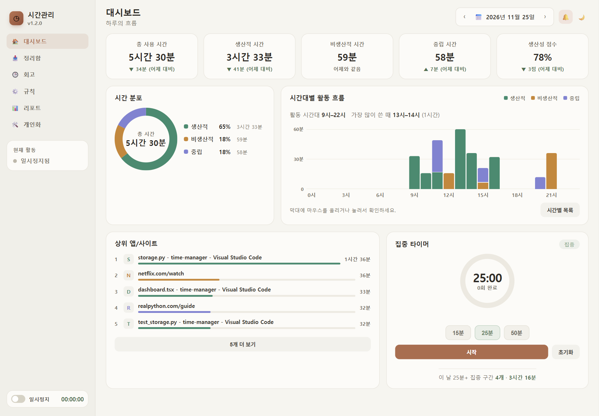
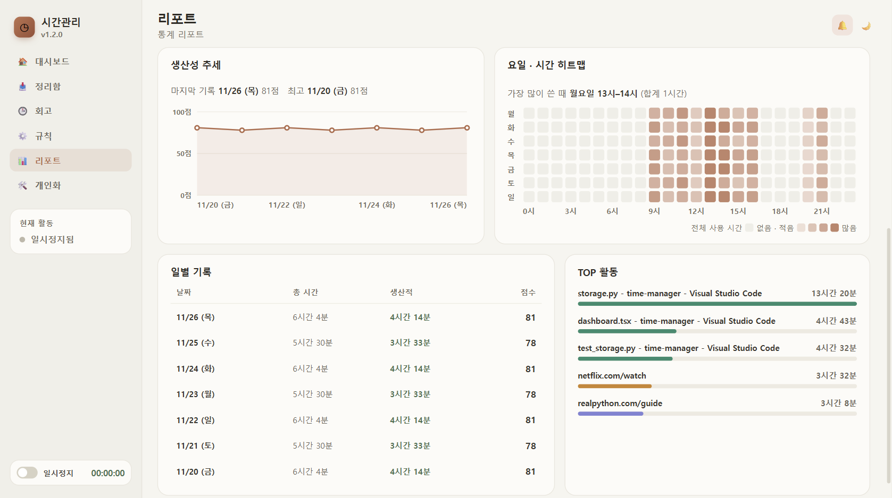
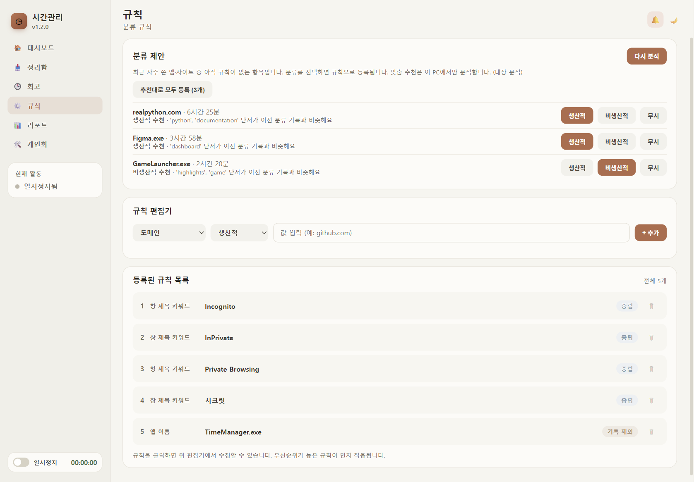

# 시간 관리 매니저 (Time Manager)

**내가 시간을 어디에 쓰는지 자동으로 기록하고 보여주는 Windows 데스크톱 앱**입니다.

지금 보고 있는 앱과 웹사이트를 알아서 기록해 **생산적 / 비생산적 / 중립** 으로 나누고, 언제 집중했고 무엇에 시간을 썼는지 한눈에 보여줍니다. 직접 시작·종료를 누를 필요가 없고, 기록과 분석은 기본적으로 **내 PC 안에서만** 이루어집니다.

<table>
<tr>
<td></td>
<td></td>
<td></td>
</tr>
<tr>
<td align="center">대시보드</td>
<td align="center">리포트</td>
<td align="center">분류 추천</td>
</tr>
</table>

<sub>화면의 데이터는 예시입니다.</sub>

---

## 주요 기능

### ⏱ 자동 기록
- 사용 중인 앱과 브라우저 주소를 자동으로 기록 (Chrome·Edge 에서 확인. Brave, Vivaldi, Opera, Firefox, Whale 은 확인 전)
  - 주소창만 읽음: 웹 페이지의 내용이나 주소창에 입력 중인 글은 저장하지 않음
- **트레이 상주:** 창을 닫아도 계속 기록. 트레이 아이콘에서 열기·일시정지·종료 (설정에서 끌 수 있음)
- 5분 동안 입력이 없으면 자리 비움으로 보고 기록을 멈춤 (1~60분으로 변경 가능)
  - **영상·회의:** 보고 있는 앱에서 소리가 나고 화면 켜짐이 유지되면 입력이 없어도 기록 (최대 3시간). 소리를 끈 영상은 알 수 없음
  - 원하면 자리 비움이 된 때에, 마지막 입력 뒤에 기록한 시간도 빼기 (기본은 꺼짐)
  - 잠금 화면은 기록하지 않음
- Time Manager 를 보는 시간은 기록하지 않음
- 앱은 하나만 실행 (다시 실행하면 열려 있는 창을 앞으로 가져옴)
- 원하는 앱은 기록에서 제외

### 📊 한눈에 보는 하루와 흐름
- **대시보드:** 사용 시간, 생산성 점수, 일간 목표 진행률, 시간대별 활동, 많이 쓴 앱·사이트 (앱·도메인 단위)
- **리포트:** 최근 7일·30일·이번 달·원하는 기간의 추세, 요일·시간 히트맵, 요일별 패턴
- **회고:** 하루의 대표 활동, 가장 큰 방해 요소, 정리가 필요한 항목, 집중 흐름
- 그래프에 마우스를 올리거나 눌러 **언제, 얼마나** 썼는지 확인 (방향키 지원)
- 기록을 CSV 로 내보내기

### 🗂 내게 맞는 분류
- 도메인·앱·창 제목 키워드 규칙을 화면에서 추가·수정·삭제
- 처음에는 모두 **중립** — 내가 정한 것만 생산적·비생산적으로 분류
- 직업별 프리셋(개발자·학생·사무직·크리에이터 등)과 **나만의 프리셋**
- **정리함:** 기록 검색·재분류·삭제·복원. 바꾼 분류는 버튼 하나로 앞으로도 적용
- **지난 기록에도 적용:** 바뀔 내용을 먼저 확인한 뒤 현재 규칙을 적용. 직접 바꾼 분류는 유지하고, 적용 전에 자동 백업

### 🎯 집중 돕기
- 15·25·50분 집중 타이머 — 다른 화면에서도 남은 시간 표시
- 비생산 활동이나 생산 활동이 오래 이어지면 알림 (1분 이하의 다른 창 전환은 이어진 것으로 봄)
- 일일·주간 목표, 일간 목표 달성 알림, 하루 마무리 요약

### ✨ 맞춤 추천 · 코칭 · 질문
- **분류 추천:** 아직 규칙이 없는 앱·사이트의 분류를 근거와 함께 제안. 확인한 뒤 한 번에 등록 가능
- **코칭:** 하루 또는 최근 7일의 기록을 바탕으로 요약과 다음 행동 제안, 지난 결과 보기
- **기록에 질문하기:** 평소 말투로 묻고 답을 확인
  - "지난주 유튜브 얼마나 봤어?"
  - "지난주랑 이번 주 생산 시간 비교해줘"
  - "이번 주 언제 가장 많이 썼어?"
  - 시간은 항상 PC 에서 계산하고, 질문을 어떻게 이해했는지 함께 표시. 이해하지 못하면 추측하지 않고 알려줌

#### 분석 방식

| 방식 | 설명 |
|---|---|
| **내장 분석** (기본, 무료) | 인터넷 없이 PC 에서만 처리. 질문은 기간·분류·앱·사이트·시간대·요일·순위·두 기간 비교 같은 간단한 형태를 이해 |
| **개인 모델** (선택) | 내가 고른 AI 서비스를 연결 |

| 개인 모델 서비스 | API 키 | 기본 주소 |
|---|---|---|
| Claude (Anthropic) | 필요 | 고정 |
| GPT (OpenAI) | 필요 | 고정 |
| Ollama | 선택 | `http://localhost:11434/v1` |
| LM Studio | 선택 | `http://localhost:1234/v1` |
| 직접 입력 (OpenAI 호환) | 선택 | 직접 입력 |

- 유료 서비스의 요금은 본인 계정에 청구. 내 PC 가 아닌 서버는 https 만 허용
- 분석 중에는 경과 시간을 보여주고 취소 가능 (이미 보낸 데이터는 되돌릴 수 없고, 유료 서비스는 요금이 청구될 수 있음)
- 실패해도 다른 방식으로 몰래 바꾸지 않음. 원하면 내장 분석으로 보기를 선택

---

## 개인정보

- 활동 기록은 **내 PC 에 저장**. 앱을 종료하면 활동 DB 를 암호화
- 영상·회의 확인은 소리의 **크기만** 읽고 내용은 읽거나 저장하지 않음
- 웹 주소는 **도메인만 저장** (새로 설치한 경우의 기본값). 전체 주소가 필요하면 설정에서 끌 수 있음
  - 이전 버전에서 업데이트하면 기존 설정을 그대로 사용 → 원하면 설정에서 켜기
- 창 제목을 저장하지 않도록 선택 가능
- 데이터 보존 기간을 정해 오래된 기록 삭제
- **개인 모델을 선택한 경우에만** AI 서버로 전송
  - 보내는 것: 앱 이름, 도메인, 집계 수치, 직업 프리셋, 목표·근무 시간. 질문 기능은 **입력한 질문 원문** 포함
  - 보내지 않는 것: 창 제목, 전체 주소
  - **전송 내용 보기** 로 보내기 전에 확인, **전송 제외 목록** 으로 특정 앱·도메인 이름 제외
  - API 키는 Windows 자격 증명 관리자에 서버별로 저장
- 그 밖의 연결: 업데이트 확인을 누르면 GitHub 에 접속. 앱이 비정상 종료되면 진단 정보를 클립보드에 복사하고 문제 신고 페이지를 염 (자동 전송 없음)

> ⚠️ **암호화되지 않는 파일:** 백업(`.tmbak`)과 CSV 파일에는 창 제목·주소가 그대로 들어 있습니다. 실행 중인 활동 DB 도 암호화되지 않은 상태입니다. 공유 폴더나 클라우드에 둘 때 주의하세요.

### 데이터 보호
- 자동 백업(약 7일마다 앱을 시작하거나 켜 둔 채 날짜가 바뀔 때, 최근 4개 유지)과 수동 백업·복원
- 복원 전에 백업 내용을 검사하고, 직전 상태를 따로 보관
- 백업을 복원해도 백업에 든 AI 연결 설정은 가져오지 않음
- 설정·규칙 파일이 손상되거나 기록의 암호를 풀 수 없으면, 원본을 지우지 않고 따로 보관한 뒤 알림

---

## 설치

**Windows 전용**입니다.

### 설치 파일
[Releases](https://github.com/gu-sean/Time-Manager/releases) 에서 `TimeManager-Setup-<버전>.exe` 를 내려받아 실행합니다.

- 기존 버전 위에 바로 설치할 수 있습니다. **설치 전에 앱을 종료하세요.** 창을 닫으면 트레이에 남으므로, 트레이 아이콘의 **종료**를 누르세요.
- 설치 파일에 코드 서명이 없어 "알 수 없는 게시자" 또는 SmartScreen 경고가 나타날 수 있습니다. 이 저장소의 Releases 에서 받은 파일인지 확인하세요.
- 업데이트할 때 달라지는 점은 [최신 릴리스 노트](https://github.com/gu-sean/Time-Manager/releases/latest)를 확인하세요.

### 소스에서 실행
Python 3.13 과 Node.js 24 에서 확인했습니다.

```powershell
pip install -r requirements.txt

cd webui
npm install
npm run build
cd ..

python main.py
```

- 소스로 실행하면 데이터는 프로젝트의 `data/` 폴더에 저장 (설치본은 `%APPDATA%\TimeManager`)

### 테스트

```powershell
pip install pytest
python -m pytest
```

---

## 기술 스택

| 영역 | 기술 |
|---|---|
| 데스크톱 | Python, pywebview (WebView2) |
| 화면 | React 19, TypeScript, Vite 8 |
| 저장·보안 | SQLite, cryptography (Fernet), keyring |
| Windows 연동 | Win32 API, uiautomation, winotify |
| AI | 자체 나이브 베이즈 분류기, Anthropic SDK, OpenAI 호환 API |
| 테스트·배포 | pytest, PyInstaller, Inno Setup |

## 프로젝트 구조

```
Time-Manager/
├── main.py                    # 진입점
├── rules.json                 # 기본 분류 규칙
├── requirements.txt
├── time_manager/              # 활동 추적, 저장, 분류, 분석, 화면과의 연결(webapi/)
├── webui/                     # React 화면
├── tests/                     # pytest 테스트
├── installer/                 # Inno Setup 설치 스크립트
├── time_manager_webview.spec  # PyInstaller 빌드 설정
└── version_info.txt           # exe 버전 정보
```